# BoardTestG
Stuart Rankin\
sjrankin@gmail.com\
21 October 2026

# Summary
A match 3 game implemented in Godot, ported from a RealityKit implementation. Subsequent additions and improvements were also done via Claude Code.

BoardTestG is a match 3 game in three dimensions. This gives the player more ways to play the game as well as be more visually appealing. Godot gives many graphical abilities that RealityKit does not have, such as built-in physic, better lighting options, shadows, and the like.

(Before SceneKit's deprecation, I would have used that. But, Apple indicated that RealityKit should be used in place of SceneKit, but RealityKit does not have the facilities needed.)

There are two general ways to play BoardTestG - in 2D or 3D (both make use of 3D elements).

This document describes what is in place now, and what is planned.

View of BoardTestG in 2D mode when initially started.\
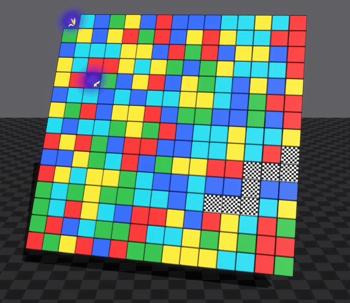\
In the animation above, the checkerboard is a hint to the user which is the next group that can be removed (it uses a very simple no-look-ahead algorithm). The two blue blobs with lightning are non-movable/removable blocks.

View of BoardTestG in 3D mode with automatic piece removal.\
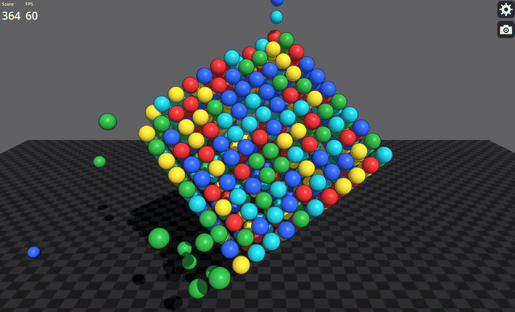\
The animation above shows the 3D cube in attract mode, showing piece removal. This gives a general idea how 3D mode looks and works.

# Modes of Play
## 2D
This is similar to a normal match 3 game, only with some 3D elements. This mode includes blockers that cannot be moved, and the usual game play (including hints for the user). The game play is the usual match 3 mechanism where the player taps on a group of pieces of at least three in quantity. The game will remove those pieces and drop existing pieces into place, backfilling if new pieces are needed. For debug purposes (and for the attract mode), if there are no playable groups, the user can reshuffle the board (or in attract mode, reshuffling happens automatically).

The animation below shows a short sequence of the 2D board in attract mode.\
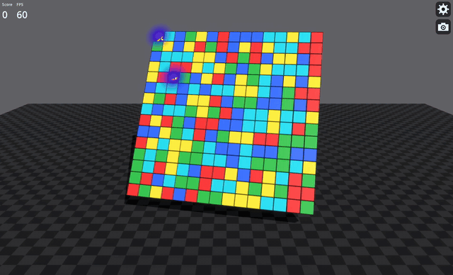
## 3D
The board is turned into a cube (or other 3D shape). (I experimented with non-cubicle shapes (spheres, cones, etc) but lining up pieces was not necessarily straightforward.) The user interacts with each face of the cube and the pieces fly away as in a 2D board. The interesting thing is a group can extend across faces so when the player removes some pieces from one face, another face is changed. Currently, the user can rotate the cube at will. Eventually, I will add a mode to retrict play to a single face at a time, which will be interesting given the possibility of changing other faces when working on a different face.\
The player has the ability to change the dimensions of the cube board.

View of a 3D cube with each side playable.\
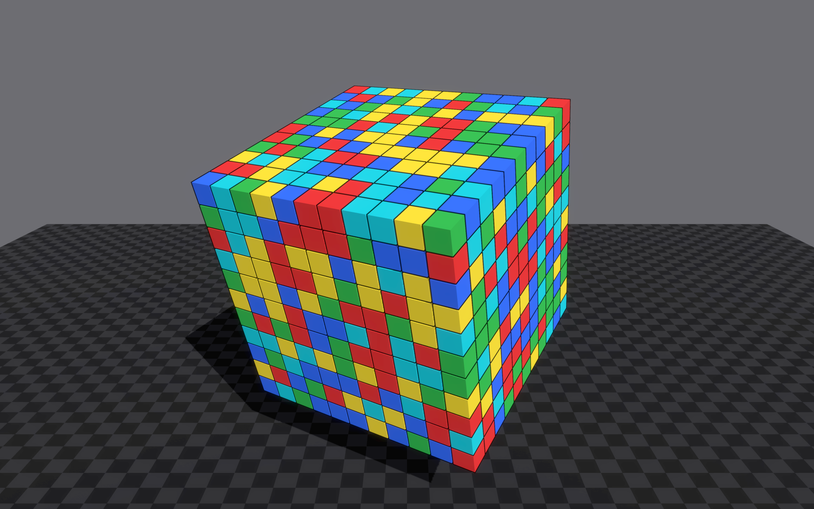\
All pieces are the same shape in 3D mode, and use the same physics as 2D for piece removal.

## Meta Game
Commercially-available match 3 games have a certain number of turns before the user loses at a given level. BoardTest G has different ways of playing:
### Turn-Limited
This is what is most commonly used by commercial games - if the user does not reach a certain goal in a pre-defined number of turns, the user loses and must start that level over again.
### Minimum Goal
This mode allows the user to make as many turns as he desired but the goal is to make the fewest possible. 
### Timed
The user must reach the level's goal within a certain amount of time (pre-defined for each level).
### No Goal
The play may play as long has he wants on a certain level. A score is kept but there is no pressure to continue to another level.

## Object Heirerachy
Game elements are defined in a heirarchy. At the top level is the scene in which the game is played. It includes background elements as well as the game board itself.

### Non-Playable
The background is present to avoid a solid color. With the elements (a sky and a floor/ground), motion can be applied to offer game tension or game status. There is no direct way for the player to interact with the background.\
Additionally game statistics are shown in the background - a score and elapsed time (which is used for debugging and performance management). A snapshot button and a settings button are also present.

### Playable
The playable object consists of a set of pieces (also called blocks). The pieces are arranged into a grid. In 3D mode, the pieces are arranged into a hollow cube.
#### Piece Types
##### Non-Blockers
Non-blocking pieces are playable and are what the user interacts with. Non-blocking pieces have a surface color from a limited set of colors and a shape selected by the user. Current shapes are:
1. Cube
2. Sphere
3. Rounded Cube
4. Cone
5. Cylinder
6. Glow
7. Joined Cubes
8. Joined Spheres
9. Joined Cylinders
10. Joined Glows

Not all of the shapes are really playable in the sense they are easy to use.\
As mentioned, colors are used to determine a group. Shapes are for visual interest only.

Some of the pieces are shown in the following images.

Standard block pieces that starts the game.\
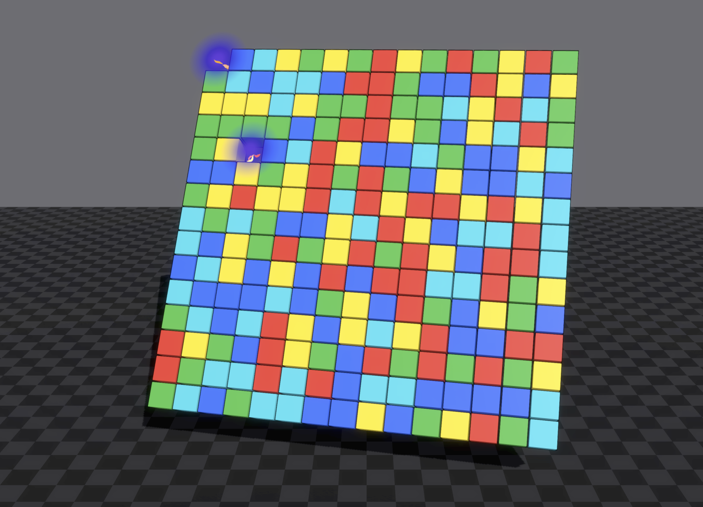

Rounded block pieces that starts the game.\
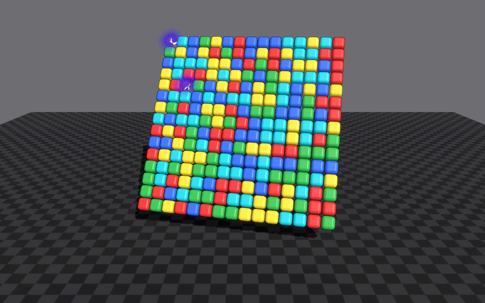

Joined block pieces (for more obvious groups).\
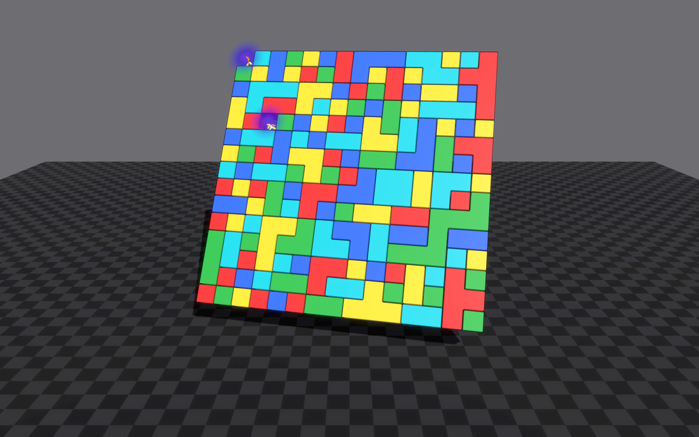

Spherical pieces - these bounce well.\
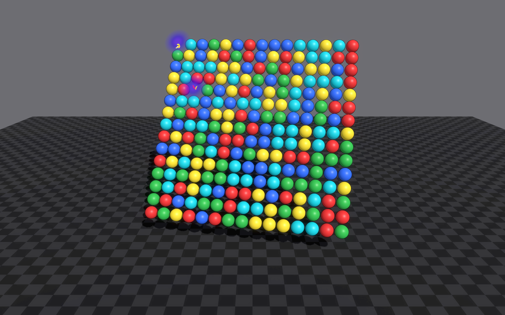

Glowing orbs pieces. These are pretty but I'm not sure I'll keep them in the game...\
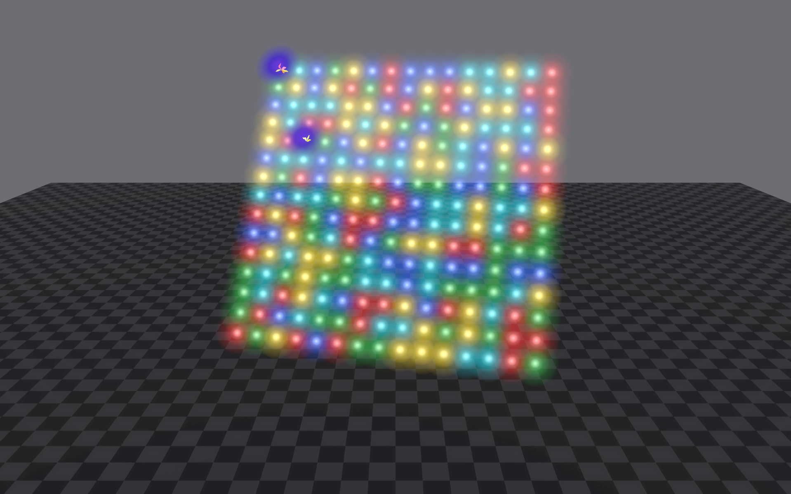

##### Blockers
Blocking pieces are cannot be directly interacted with. They block the pieces above them (logically) from flowing directly down, requiring the game engine to flow around the block.\
Currently, blockers are animated indigo orbs with lightning bolts.

Short animation of a blocker piece.\
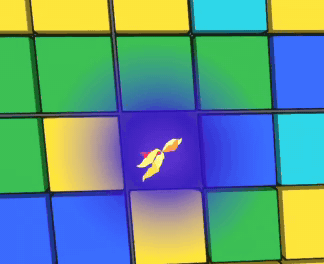

## Implementation
The initial program, BoardTestRK was implemented with Apple's SDKs and Swift. I created a framework and then used Claude to fill it in.

### Claude
For BoardTestG, the port was done by Claude, as well as all further implementation. The program was implemented this way as a test to see how well Claude could be used to port from RealityKit (it did a good job). For maximum compatibility, I told Claude to use Godot's native scripting system rather than C# or Swift.

### Graphics
Native graphics capabilities of Godot were used extensively. I was most curious about the features missing from RealityKit such as shadows and diffuse glows, both supported natively in Godot.\
I added a lightning effect to show certain types of action - blockers have lightning to show they are "dangerous" and when the user taps a group, a lightning effect is shown as well.

### Physics
BoardTestG makes heavy use of Godot's physics engine in piece movement. This includes:

1. Piece removal - there are four current ways a piece can be removed: 1) simply disappear, 2) fly out and bounce until they timeout and fade away, 3) explode into small pieces and bounce on the board, and 4) break into smaller versions of the large piece and bound on the board. The bouncing uses a lot of physics processing. (Modeling of the shape to roll as expected as well as collision detection and interactions.)
2. General piece motion in the board.

Examples of block removal physics are shown below:

Depending on the angle of the board, pieces will fly out or bounce on top of the board and roll off.\
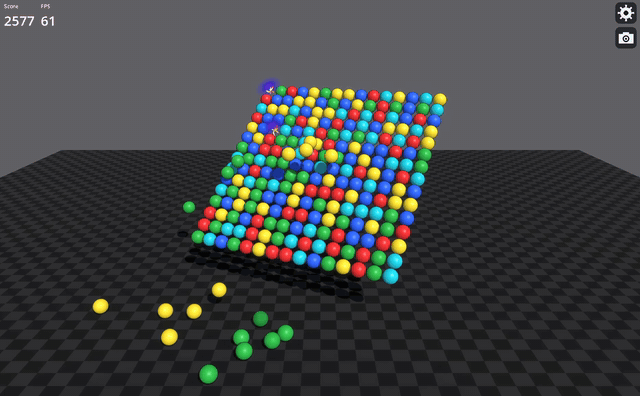

This type of removal involves creating several smaller version of the piece to be removed, then popping them off of th board.\
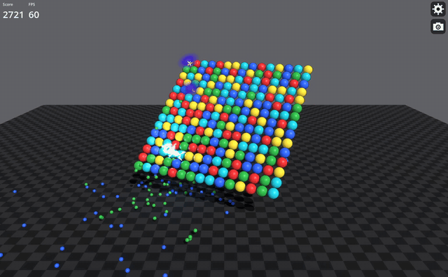

The final type is fracturing the pieces and flinging the result across the game\
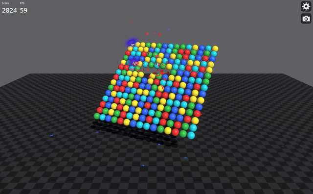

### Game User Interface
I used a minimum user interface for the game. It is mostly debug-controls and ways to test game play. A final UI will consist of controls on the main page (eg, play, reset, and the like).

## Compiling
I usually just compile via the Godot IDE and run and test the code there. I exported the game to an iPad and and it there as well.

Be sure to use the proper version of the export modules (they must match the version of Godot you are running). The resultant binary can be quite large.

BoardTestG has a built-in rate limiter for mobile devices but the player change change that in the settings.

# Current Status
## Debug
BoardTestG is in development and has a great number of debug features. If commercialized, these features would be removed.
## Levels
BoardTestG effectively has only one level at this time. The size of the board can be controlled by the user and blockers can be added randomly. To be viable, a set of pre-canned levels needs to be added. Additionally, special pieces need to be implemented.\
It may be possible to create levels programmatically but care would need to be taken to not create impossible levels.
