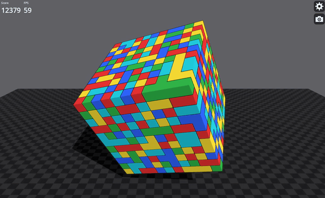
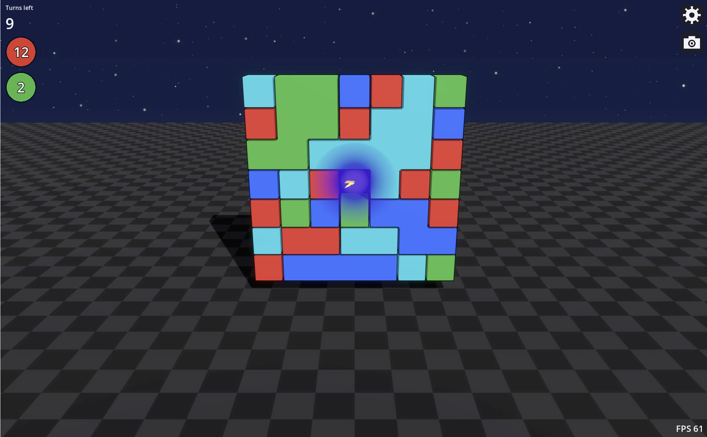

# BoardTestG
Stuart Rankin\
sjrankin@gmail.com\
21 October 2026

# Summary
This describes BoardTestG, a proof of concept for a match 3 game in three dimensions. The game is used to test game modes and play.

At a glance:
- A flat 2D board and a 3D cube, switchable in Settings. In 3D the width, height and depth of the cube can be changed.
- Real physics for the pieces that are removed, and real (world) gravity for the pieces that remain.
- Groups can wrap around the edges of the cube into other faces.
- Ten piece shapes and six ways to remove pieces.
- An attract mode that plays the game by itself.
- Tested on a Mac and on an iPad and should run wherever Godot runs.

View of BoardTestG in 2D mode when initially started.\
\
In the animation above, the checkerboard is a hint to the player showing the next group that can be removed (it uses a very simple no-look-ahead algorithm). The two blue blobs with lightning are non-movable/removable blocks.

View of BoardTestG in 3D mode with automatic piece removal.\
\
The animation above shows the 3D cube in attract mode, showing piece removal. This gives a general idea how 3D mode looks and works.

## Why a Game Engine
A game engine was selected for better physics and graphics. Apple's SceneKit is being deprecated, and its replacement, RealityKit, is missing some features needed for the game (shadows, some lighting, some physics). Godot was selected due to its open source nature.

# How to Play
- **Remove a group:** tap or click a group of three or more touching pieces of the same color.
- **Turn the board:** drag. In 3D the cube follows the mouse (or your finger) whichever way it is turned. The mouse wheel zooms.
- **Settings:** the gear at the top right opens them. They are grouped into Game (shuffle, attract mode, auto rotate, recenter), Board (2D or 3D, size, colors, blockers), Pieces (shape, glossy pieces), Effects (how pieces are removed, lightning, removal speed) and Performance (frame-rate limit).
- **Screenshot:** the camera button under the gear (on a Mac) saves a picture to the Pictures folder.
- **Attract mode:** turn it on in Settings and the game plays itself.

# Modes of Play
In both 2D and 3D, games proceed by removing a minimum of three contiguous pieces of the same color. The player taps or clicks (depending on the platform) on such a group, and those pieces are removed. Existing pieces from above fill in the newly created gaps, and new pieces fall in from above to backfill the gaps.

In 3D mode, groups may wrap around the cube edge into other faces and vertices. When the player removes such a group, all pieces in the group, regardless of the face, are removed.

Animation of multi-face group removal.\
\
You can see groups that are on multiple faces removed as a whole.

## 2D
This is similar to a normal match 3 game, only with some 3D elements. This mode includes blockers that cannot be moved, and the usual game play (including hints for the player). The game play is the usual match 3 mechanism where the player taps on a group of pieces of at least three in quantity. The game will remove those pieces and drop existing pieces into place, backfilling if new pieces are needed. For debug purposes (and for the attract mode), if there are no playable groups, the player can reshuffle the board (or in attract mode, reshuffling happens automatically).

The animation below shows a short sequence of the 2D board in attract mode.\

## 3D
The board is turned into a cube (or other 3D shape). (I experimented with non-cubic shapes (spheres, cones, etc) but lining up pieces was not necessarily straightforward.) The player interacts with each face of the cube and the pieces fly away as in a 2D board. The interesting thing is a group can extend across faces so when the player removes some pieces from one face, another face is changed. Currently, the player can rotate the cube at will. Eventually, I will add a mode to restrict play to a single face at a time, which will be interesting given the possibility of changing other faces when working on a different face.\
The player can change the width, height and depth of the cube (3 to 15 each) in Settings.\
Hints and blockers do not apply in 3D mode.

View of a 3D cube with each side playable.\
\
Any of the piece shapes can be used in 3D mode (the joined shapes join across the edges of the cube too). Removed pieces pop out of the face they were on (out between the two faces, for a piece on an edge) and then (with Fly Away, the default) fall, bounce and fade under the same physics as in 2D.\
In attract mode the game picks one of the six faces at random and removes the largest group on it, and the cube turns slowly about all three axes. The turning can be switched off in Settings (Random rotation in Attract Mode).

### Falling/Filling
Removed blocks may arc out or fall in other ways depending on how the player selects the removal effect but in all cases, the gravitational vector (down in the view) is used for dropping blocks. When adding new blocks, they fall in from the top to the required location and slot themselves into the newly empty spots. 2D is much simpler than the 3D shape but follows analogously.

In 3D the cube turns under gravity, so "the top" is whichever surface is highest at that moment. A gap is filled by the piece above it falling in, running down a face, around an edge and onto the next face. New pieces enter only at the top, so as the cube turns, a different surface is the one that gets fed. A gap that nothing can fall into (a level underside, say) is filled by a piece sliding in along the surface, and the gap that leaves is then filled from the top.

## Game Play
Commercially available match 3 games have a certain number of turns before the player loses at a given level. BoardTestG will have different ways of playing (none of these is implemented yet):
### Piece Removal (implemented)
The user must remove a set number of pieces from the board, based on color within a certain number of turns.

\
This image shows the board in color removal game play. The circles to the upper-left show the colors and the quantity needed to be removed.
### Minimum Goal
This mode allows the player to make as many turns as desired but the goal is to make the fewest possible.  This is a form of the Zen mode. 
### Timed (implemented)
The player must reach the level's goal within a certain amount of time (pre-defined for each level).
### Zen (implemented)
The player may play as long as they want on a certain level. A score is kept but there is no pressure to continue to another level. 

## Levels
Game levels are currently hard-coded in the app in `Levels.gd`.

## Object Hierarchy
Game elements are defined in a hierarchy. At the top level is the scene in which the game is played. It includes background elements as well as the game board itself.

### Non-Playable
The background is present to avoid a solid color. With the elements (a sky and a floor/ground), motion can be applied to offer game tension or game status. There is no direct way for the player to interact with the background.\
Additionally, game statistics are shown in the background - a score and elapsed time (which is used for debugging and performance management). A snapshot button and a settings button are also present.

### Playable
The playable object consists of a set of pieces (also called blocks). The pieces are arranged into a grid. In 3D mode, the pieces are arranged into a hollow cube.
#### Piece Types
##### Non-Blockers
Non-blocking pieces are playable and are what the player interacts with. Non-blocking pieces have a surface color from a limited set of colors and a shape selected by the player. Current shapes are:
1. Cube
2. Sphere
3. Rounded Cube
4. Cone
5. Cylinder
6. Glow
7. Joined Cubes
8. Joined Spheres
9. Joined Cylinders
10. Joined Glow

Not all of the shapes are really playable in the sense that they are easy to use.\
As mentioned, colors are used to determine a group. Shapes are for visual interest only.

Some of the pieces are shown in the following images.

Standard block pieces that start the game.\

Rounded block pieces.\

Joined block pieces (for more obvious groups).\

Spherical pieces - these bounce well.\

Glowing orb pieces. These are pretty but I'm not sure I'll keep them in the game...\

##### Blockers
Blocking pieces cannot be directly interacted with. They block the pieces above them (logically) from flowing directly down, requiring the game engine to flow around the block.\
Currently, blockers are animated indigo orbs with lightning bolts.

Blockers are only used on the 2D board.

Short animation of a blocker piece.\

## Implementation
The initial program, BoardTestRK, was implemented with Apple's SDKs and Swift. I created a framework and then used Claude to fill it in.

### Claude
For BoardTestG, the port was done by Claude, as well as all further implementation. The program was implemented this way as a test to see how well Claude could be used to port from RealityKit (it did a good job). For maximum compatibility, I told Claude to use Godot's native scripting system rather than C# or Swift.

### Graphics
Native graphics capabilities of Godot were used extensively. I was most curious about the features missing from RealityKit such as shadows and diffuse glows, both supported natively in Godot.\
I added a lightning effect to show certain types of action - blockers have lightning to show they are "dangerous" and when the player taps a group, a lightning effect is shown as well.

### Physics
BoardTestG makes heavy use of Godot's physics engine in piece movement. This includes:

1. Piece removal - there are six ways a piece can be removed. Three use physics: 1) fly out and bounce until they time out and fade away (Fly Away), 2) break into smaller versions of the large piece and bounce on the board (Mini Me), and 3) explode into small flat pieces and bounce on the board (Explode). The bouncing uses a lot of physics processing. (Modeling of the shape to roll as expected as well as collision detection and interactions.) Three play in place, over half a second at most, and need no physics: 4) disappear at once (Disappear), 5) spin on a random axis while shrinking to nothing (Spin and Shrink), and 6) spin at full size and then disappear (Spin then Vanish). New pieces wait for the effect to finish before they fall in.
2. General piece motion in the board.

Examples of block removal physics are shown below:

In Fly Away, depending on the angle of the board, pieces will fly out or bounce on top of the board and roll off.\

Mini Me involves creating several smaller versions of the piece to be removed, then popping them off of the board.\

Explode fractures the pieces and flings the result across the board.\

### Game User Interface
I used a minimal user interface for the game. It is mostly debug-controls and ways to test game play. A final UI will consist of controls on the main page (e.g., play, reset, and the like). See "How to Play" above for the current controls.

## Requirements
Godot 4.6 or newer. Built and tested on 4.7.2. Running on a Mac needs only Godot; building for an iPhone or iPad also needs Xcode (below).

## Setting up for development
This section written by Claude.

### 1. Tools (macOS)
- **Godot 4.7.2** (4.6 and newer should work), installed as `/Applications/Godot.app`.
- **Git** (`xcode-select --install` provides it).
- Only for iPhone and iPad builds: **Xcode** from the App Store (a recent release with the iOS 26 SDK). Open it once so it
  finishes installing its components, then run `sudo xcode-select -s /Applications/Xcode.app`.

### 2. Get the code and run it
    git clone https://github.com/sjrankin/BoardTestG.git
    cd BoardTestG
    /Applications/Godot.app/Contents/MacOS/Godot --headless --path . --import

The import step is needed the first time (it builds Godot's class cache). Then open `project.godot` in Godot (Project Manager >
Import) and press Play (F5).

### 3. Run the tests (optional)
    G=/Applications/Godot.app/Contents/MacOS/Godot
    $G --headless --path . --script res://Tests/TestGameSession.gd

Also `TestBoardModel.gd`, `TestCubeModel.gd` and `TestCubeView.gd`. Each prints `ALL PASS`; a script error can still end in
`ALL PASS`, so read the whole output. `CLAUDE.md` describes how the code is laid out.

### 4. Export templates (needed for any export)
In Godot: Editor > Manage Export Templates > Download and Install. The templates must match the editor's version exactly
(4.7.2). The exported binary can be quite large.

### 5. On a Mac
Pressing Play in the Godot editor is how this has been run and tested. The project also has a "macOS" export preset
(Project > Export); it has no signing identity or team set and has not been tried on another machine, so set your own before
exporting.

### 6. On an iPhone or iPad
You need an Apple ID added in Xcode (Settings > Accounts); a free account can install on your own device.
1. In Project > Export > iOS, set **App Store Team ID** to your own team and **Bundle Identifier** to one you own (for example
   `com.yourname.BoardTestG`). The preset in the repository has the owner's values; do not commit yours.
2. Export (from the project folder):

       $G --headless --path . --export-debug iOS iOS/XBoardTest.xcodeproj

3. `cd iOS && python3 patch_project.py` (marks the Xcode project device-only).
4. Open `iOS/XBoardTest.xcodeproj` in Xcode, choose your own team under Signing & Capabilities (automatic signing), pick your
   iPhone or iPad as the run destination and press Run. The first time, trust your developer profile on the device (Settings >
   General > VPN & Device Management).
5. The device must run iOS 26 or later (the preset's minimum) and have Developer Mode on (Settings > Privacy & Security).

Nothing under `iOS/` is committed except its notes and scripts, so the Xcode project only exists after step 2. Use a real
device, not the Simulator: Godot 4.7.2's iOS template does not run on it (details in `iOS/README.md`).

BoardTestG has a built-in rate limiter for mobile devices (60 per second) but the player can change that in the settings.

# Roadmap
- [X] **Game play:** scoring goals and duration, as described under Game Play above (Turn-Limited, Minimum Goal, Timed, No Goal).
- [X] **Levels:** BoardTestG effectively has only one level at this time. The size of the board can be controlled by the player and blockers can be added randomly. To be viable, a set of pre-canned levels needs to be added. It may be possible to create levels programmatically but care would need to be taken to not create impossible levels.
- [ ] **Special pieces.**
- [ ] **Single-face mode in 3D:** restrict play to one face of the cube at a time.
- [ ] **Clean-up:** remove debug and fine-tuning code and UI.
